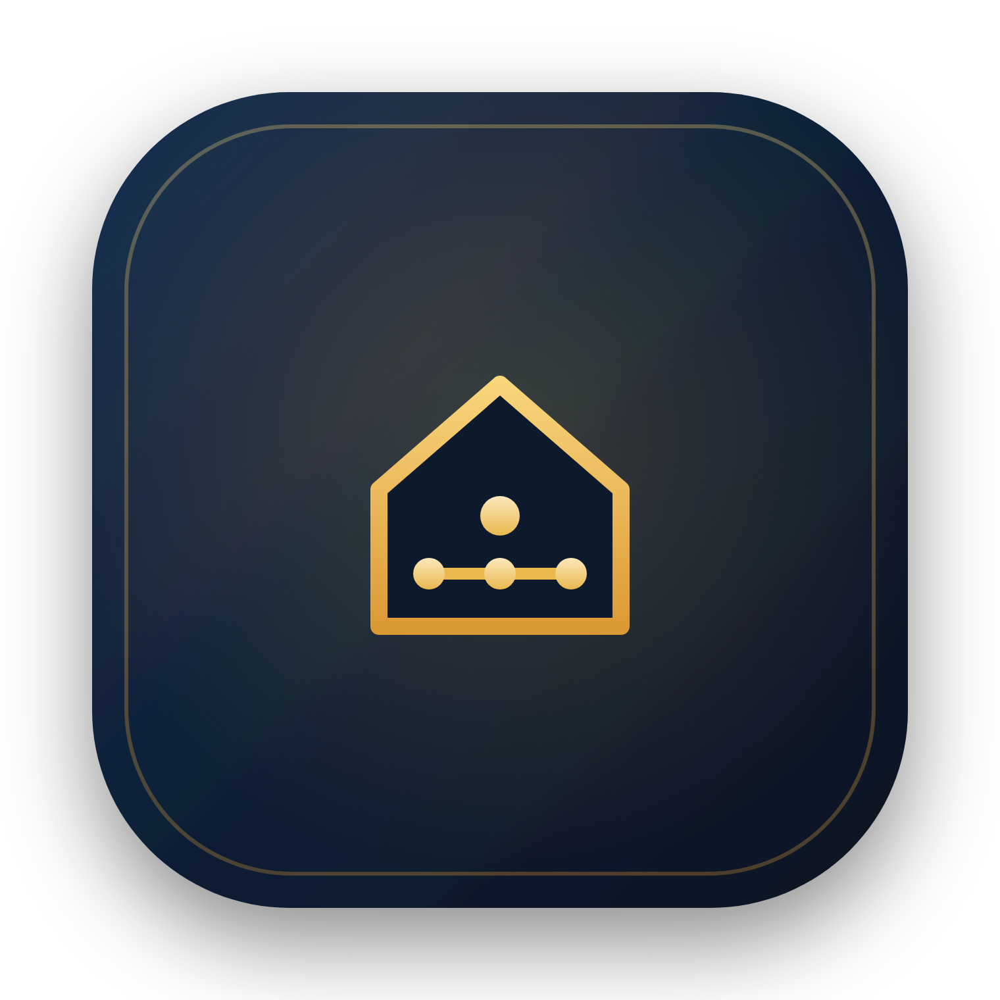
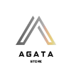
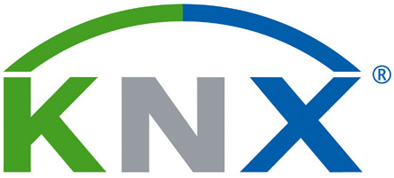

  

## The most popular KNX node for Node-RED

KNX Ultimate provides KNX/IP and KNX Secure communication, ETS project import, routing, diagnostics, virtual devices and automation utilities.

 

[![NPM version][npm-version-image]][npm-url]
[![Node.js version][node-version-image]][npm-url]
[![Node-RED Flow Library][flows-image]][flows-url]
[![Docs][docs-image]][docs-url]
[![Commit activity][commit-activity-image]][commit-activity-url]
[![Last commit][last-commit-image]][last-commit-url]
[![NPM downloads per month][npm-downloads-month-image]][npm-url]
[![NPM downloads total][npm-downloads-total-image]][npm-url]
[![MIT License][license-image]][license-url]
[![JavaScript Style Guide][standard-image]][standard-url]
[![Youtube][youtube-image]][youtube-url]

  

## Our trusted partners

  &nbsp;&nbsp;
  &nbsp;&nbsp;
  &nbsp;&nbsp;
  &nbsp;&nbsp;
  &nbsp;&nbsp;
  &nbsp;&nbsp;
  &nbsp;&nbsp;
  &nbsp;&nbsp;
  &nbsp;&nbsp;

## Friendly communities around the world

<table>
  <tr>
    <td align="center" width="33%"> <strong>Italy · VivereSmart</strong> <a href="https://www.facebook.com/groups/viveresmart">Community</a> · <a href="https://www.youtube.com/channel/UC6GlFhcbNuoSEejZ_HlCynA">VivereSmart TV</a></td>
    <td align="center" width="33%"> <strong>Germany · KNX User Forum</strong> <a href="https://knx-user-forum.de/forum/öffentlicher-bereich/knx-eib-forum/1389088-knx-node-for-node-red">Visit the discussion</a></td>
    <td align="center" width="33%"> <strong>China · QQ Group</strong> QQ group 837579219</td>
  </tr>
</table>

---

## 🚨 IMPORTANT — UPGRADING FROM VERSION 7.1.4 🚨

> ### Preferred: migrate before installing version 8
>
> Install version 7.1.4 first, then use **Upgrade to v8** from any KNX Ultimate node.
>
> ### The migration is fully automated with the push of a button
>
> If version 8 was installed directly from an older v7, restart Node-RED and open the editor: the built-in recovery bridge offers the same protected backup, package installation, conversion and Deploy. Legacy KNX AI nodes still require manual replacement or removal.
>
> ▶️ **[Watch the KNX Ultimate 7 → 8 migration video](https://youtu.be/fpNNi1jZZSc)** _(Italian)_
>
> **Follow the [upgrade steps](https://www.maxsupervibe.com/docs/knx-ultimate/migration-8/) to keep your flows working.**

### Native seamless integrations

- **Philips Hue:** install `node-red-contrib-hue-ultimate`.
- **Matter Controller and Matter Bridge:** install `node-red-contrib-matter-ultimate`. Select your existing KNX gateway in those nodes to enable KNX integration. The package can also work without KNX Ultimate.
- **AI-driven KNX control, on-field diagnostics and unit testing for KNX installers:** install `node-red-contrib-cerebrum-ultimate`.

---

## Made in Italy

  

**Designed, engineered, and supported in Italia.** KNX-Ultimate is developed and tested on real installations, with a strong focus on reliability and long-term maintainability.

   
  Authorized KNX logo by KNX Association*  Officially recognized for compliant KNX integrations.

<em>*The author <strong>Massimo Saccani</strong> has been authorized to use the KNX logo. Forks of the knx-ultimate node are not implicitly allowed to use the KNX logo.</em>

---

## 📘 Documentation

The full documentation, in six languages, with every node, KNX Utility function, Philips Hue, Matter and practical examples, is on **[maxsupervibe.com](https://www.maxsupervibe.com/docs/knx-ultimate/)**:

  <a href="https://www.maxsupervibe.com/docs/knx-ultimate/">📘 Go to documentation (English)</a> 
  <a href="https://www.maxsupervibe.com/it/docs/knx-ultimate/">📘 Vai alla documentazione (Italiano)</a> 
  <a href="https://www.maxsupervibe.com/de/docs/knx-ultimate/">📘 Zur Dokumentation (Deutsch)</a> 
  <a href="https://www.maxsupervibe.com/fr/docs/knx-ultimate/">📘 Accéder à la documentation (Français)</a> 
  <a href="https://www.maxsupervibe.com/es/docs/knx-ultimate/">📘 Ir a la documentación (Español)</a> 
  <a href="https://www.maxsupervibe.com/zh-cn/docs/knx-ultimate/">📘 前往文档 (中文)</a> 

<a href="https://github.com/Supergiovane/node-red-contrib-knx-ultimate/blob/main/CHANGELOG.md"
      style="display:inline-flex;align-items:center;gap:10px;padding:12px 24px;border-radius:999px;background:#ffc439;color:#111;font-weight:700;text-decoration:none;box-shadow:0 16px 30px rgba(255,196,57,0.32);">
      CHANGELOG
    </a>

 

[license-image]: https://img.shields.io/github/license/Supergiovane/node-red-contrib-knx-ultimate?color=blue
[license-url]: https://github.com/Supergiovane/node-red-contrib-knx-ultimate/blob/main/LICENSE
[npm-url]: https://npmjs.org/package/node-red-contrib-knx-ultimate
[npm-version-image]: https://img.shields.io/npm/v/node-red-contrib-knx-ultimate.svg
[node-version-image]: https://img.shields.io/node/v/node-red-contrib-knx-ultimate?logo=node.js&logoColor=white
[npm-downloads-month-image]: https://img.shields.io/npm/dm/node-red-contrib-knx-ultimate.svg
[npm-downloads-total-image]: https://img.shields.io/npm/dt/node-red-contrib-knx-ultimate.svg
[standard-image]: https://img.shields.io/badge/code_style-standard-brightgreen.svg
[standard-url]: https://standardjs.com
[youtube-image]: https://img.shields.io/badge/YouTube-Playlists-red?logo=youtube&logoColor=white
[youtube-url]: https://www.youtube.com/channel/UCA9RsLps1IthT7fDSeUbRZw/playlists
[docs-image]: https://img.shields.io/badge/Docs-maxsupervibe.com-2ea44f
[docs-url]: https://www.maxsupervibe.com/docs/knx-ultimate/
[commit-activity-image]: https://img.shields.io/github/commit-activity/m/Supergiovane/node-red-contrib-knx-ultimate?logo=github
[commit-activity-url]: https://github.com/Supergiovane/node-red-contrib-knx-ultimate/commits/master
[last-commit-image]: https://img.shields.io/github/last-commit/Supergiovane/node-red-contrib-knx-ultimate?logo=github
[last-commit-url]: https://github.com/Supergiovane/node-red-contrib-knx-ultimate/commits/master
[github-image]: https://img.shields.io/badge/GitHub-Repository-000000
[github-url]: https://github.com/Supergiovane/node-red-contrib-knx-ultimate
[flows-image]: https://img.shields.io/badge/Node--RED-Flow%20Library-white?logo=nodered&logoColor=8F0000
[flows-url]: https://flows.nodered.org/node/node-red-contrib-knx-ultimate
[paypal-image]: https://img.shields.io/badge/Support-PayPal-blue
[paypal-url]: https://www.paypal.com/donate/?hosted_button_id=S8SKPUBSPK758
[docs-button-image]: https://img.shields.io/badge/Docs-Open%20Documentation-0d4c70?style=for-the-badge&logo=book&logoColor=f4fbff
